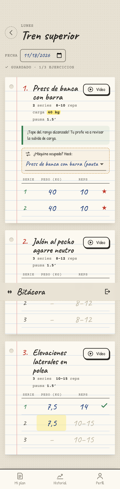
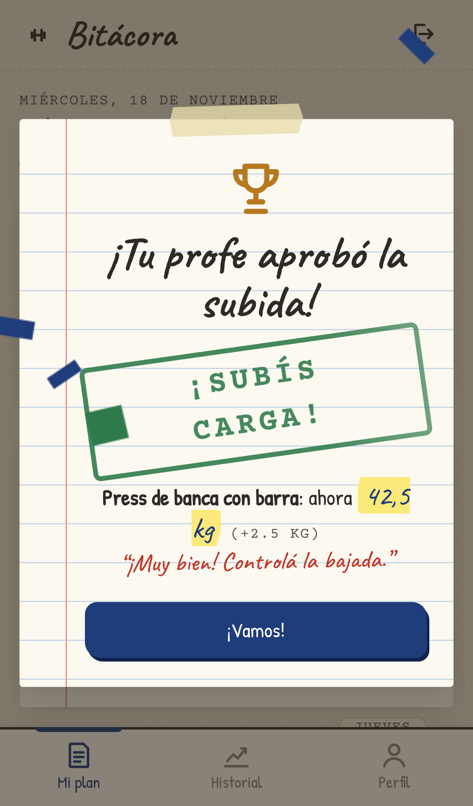
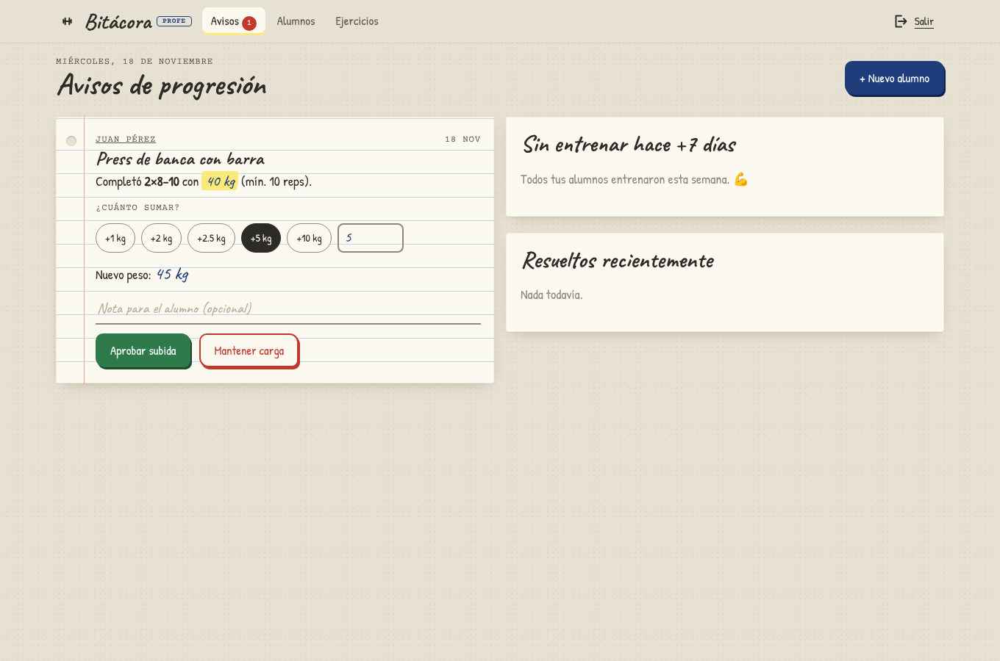
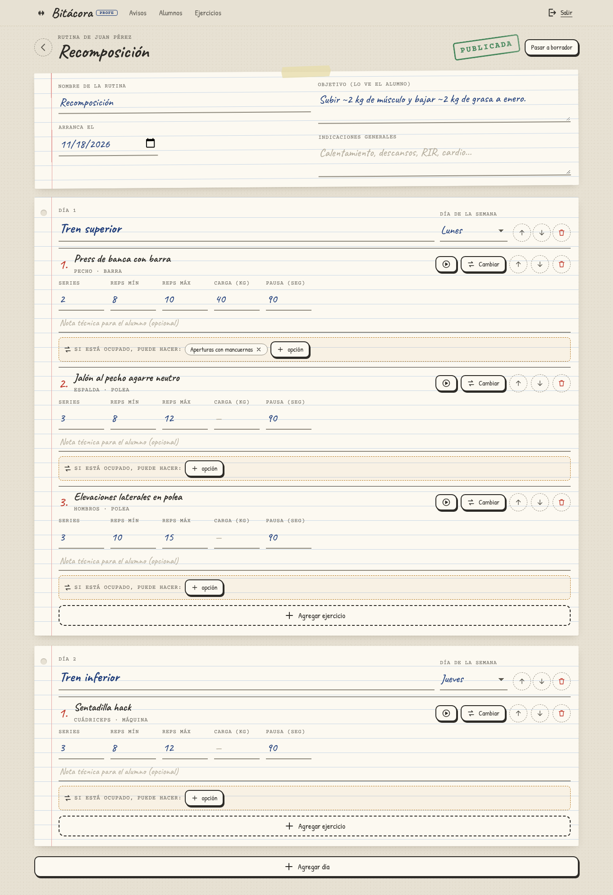

# Entrena con Fede — rutinas personalizadas y progreso

Web app para profe y alumnos. Funciona en el celular (se puede instalar como app desde el navegador) y en la compu. La estética es la de una planilla de papel: renglones, tinta azul, sellos y post-its.

## Capturas

| Alumno: planilla del día | Alumno: festejo | Profe: avisos de progresión |
|---|---|---|
|  |  |  |




## Qué hace

**Alumno** (pensado para el celular)
- Ve su plan con el objetivo, los días de la semana y los ejercicios (series, rango de reps, carga, pausa y nota del profe).
- Carga peso y reps por serie. Se guarda al salir de cada casillero, muestra en lápiz lo que hizo la sesión anterior y copia el peso de la serie anterior.
- Si la máquina está ocupada, elige una de las opciones de reemplazo que dejó el profe.
- Ve el video y la pauta técnica de cada ejercicio.
- Historial semanal, agrupado por día de entrenamiento (por ejemplo, tren superior) y dentro de cada día por ejercicio: peso máximo, volumen y repeticiones.
- Mediciones cada 2 semanas (peso, cintura, pecho, cadera, brazo, muslo y % de grasa), con aviso cuando toca medirse.
- Edita su nombre, edad y teléfono, y cambia su contraseña.
- **Doble progresión:** cuando completa todas las series en el tope del rango con la carga pautada, la app le avisa al profe. Cuando el profe aprueba, el alumno ve un festejo con sello y confeti, y la carga nueva ya queda en su planilla.

**Profe** (pensado para la compu, también funciona en el celular)
- Alta, baja y modificación de alumnos, de dos formas: invitación por mail o contraseña temporal. También puede pausar o reactivar el acceso, reenviar el mail de contraseña o eliminar al alumno.
- Armador de rutinas:
  - Plantillas de días.
  - Buscador instantáneo de ejercicios (sin importar acentos, con filtro por grupo muscular).
  - Botón "Cambiar" para reemplazar un ejercicio.
  - "Opciones de reemplazo" por si el ejercicio no está disponible en el gym.
  - Ordenar, duplicar y publicar rutinas.
- Biblioteca de 130 ejercicios en español con pauta técnica. A cada ejercicio le pegás el link de YouTube que prefieras (o un video tuyo) y se ve embebido.
- Bandeja de **avisos de progresión**: elegís cuánto sumar (+1, +2, +2,5, +5, +10 o cualquier otro valor), dejás una nota y aprobás o mantenés la carga. El alumno se entera al abrir la app.
- Historial de cada alumno en modo lectura: gráficos semanales por ejercicio y medidas.
- Lista de alumnos que no entrenan hace más de 7 días.

**Seguridad:** login con email y contraseña, y recuperación por mail (el link funciona aunque se abra en otro dispositivo). Toda la seguridad está en la base de datos (Row Level Security):
- Cada alumno ve sólo lo suyo.
- Cada profe ve sólo a sus alumnos.
- Sólo el profe puede crear o modificar rutinas.
- El alumno no puede cambiarse el rol.

## Tecnología

- Next.js 15 (App Router) + React 19 + TypeScript.
- Supabase: Postgres, Auth y Row Level Security.
- Sin librerías de UI: CSS propio y gráficos SVG propios.

## Publicarla (gratis): Supabase + Vercel

### 1. Base de datos (Supabase)
1. Creá un proyecto en <https://supabase.com>.
2. **SQL Editor → New query**: pegá y ejecutá todo `supabase/migrations/0001_schema.sql`.
3. Ejecutá también `supabase/seed_exercises.sql` (catálogo de ejercicios) y `supabase/seed_foods.sql` (base de alimentos).
4. **Authentication → Sign In / Providers → Email**: desactivá *Allow new users to sign up*. Así sólo entran los alumnos que das de alta vos.
5. **Authentication → Users → Add user**: creá tu usuario de profe con tu email y contraseña. **El primer usuario que se crea queda como profe.**
6. **Authentication → URL Configuration**:
   - *Site URL*: la URL de la app, por ejemplo `https://entrena-con-fede.vercel.app`.
   - *Redirect URLs*: agregá `https://entrena-con-fede.vercel.app/**`.
7. **Mails (importante):** el servidor de mail que trae Supabase de fábrica manda muy pocos mails por hora y sólo es para pruebas. Para las invitaciones y la recuperación de contraseña configurá un SMTP propio en **Authentication → Emails → SMTP Settings**. Por ejemplo [Resend](https://resend.com), que es gratis hasta 3.000 mails por mes.
   - Mientras tanto podés dar de alta a los alumnos con **contraseña temporal**, que no necesita mail.
   - Opcional: en **Authentication → Emails → Templates** podés traducir los textos de los mails al español.

### 2. App (Vercel)
1. Subí esta carpeta a un repositorio de GitHub.
2. En <https://vercel.com> importá el repositorio.
3. Cargá las variables de entorno. Están en `.env.example` y los valores salen de Supabase → *Project Settings → API*:
   - `NEXT_PUBLIC_SUPABASE_URL`
   - `NEXT_PUBLIC_SUPABASE_ANON_KEY`
   - `SUPABASE_SERVICE_ROLE_KEY`: es secreta, nunca la compartas.
   - `NEXT_PUBLIC_SITE_URL`: la URL final de la app.
   - `ANTHROPIC_API_KEY` (opcional): para la revisión de rutinas con IA (ver más abajo).
4. Deploy. Entrá con tu usuario de profe.

### 3. Instalarla en el celular
Abrí la URL en el celular:
- iPhone: Safari → Compartir → *Agregar a pantalla de inicio*.
- Android: Chrome → menú → *Instalar app*.

## Sesión de entrenamiento

- El alumno toca **Iniciar entrenamiento** (o simplemente carga la primera serie) y arranca un cronómetro.
- **Finaliza** solo cuando todas las series tienen peso y reps (o fueron salteadas), o cuando el alumno toca **Finalizar**. Si faltan series, la app las lista y pide confirmación.
- Si cambia de sección a mitad del entrenamiento, la app pregunta si quiere ver otra sección (sigue entrenando, con una barra para volver) o finalizar.
- A la **1,5 h** sin finalizar le llega una notificación ("¿Seguís entrenando?"). La manda una tarea programada de Supabase (pg_cron, cada 5 minutos) que no requiere configuración.
- Se puede **saltear una serie o un ejercicio** con un motivo (máquina ocupada, dolor, sin tiempo…). Al finalizar, si hubo series salteadas o sin cargar, al profe le llega una notificación y lo ve en **Avisos → Entrenamientos incompletos**.

## Notificaciones

Los alumnos y el profe activan las notificaciones desde la app (botón **Activar**, en el inicio o en el perfil). No hace falta configurar nada: las claves se generan solas la primera vez.
- **Al alumno le llega:** rutina nueva, plan de alimentación nuevo, subida de carga aprobada o no.
- **Al profe le llega:** un alumno llegó al tope del rango, o un alumno cerró el día de dieta.
- **En iPhone** primero hay que agregar la app a la pantalla de inicio (Safari → Compartir → *Agregar a inicio*) y abrirla desde ahí (iOS 16.4 o posterior).

## Sin señal en el gimnasio

Si se corta la conexión mientras el alumno carga series, cada serie queda guardada en el teléfono y se sube sola cuando vuelve la señal (o con *Reintentar ahora*). Para que funcione, la planilla del día tiene que estar abierta antes de perder la señal.

## Backups automáticos

Todos los días a las 03:17 (hora argentina), GitHub Actions hace una copia de la base y la guarda 30 días en la pestaña **Actions** del repositorio. Aprovecha esa consulta diaria para que Supabase no pause el proyecto por inactividad.

**Configurarlo (una sola vez).** En GitHub, *Settings → Secrets and variables → Actions → New repository secret*:
- `SUPABASE_DB_URL`: en Supabase, botón **Connect** → *Session pooler* → copiá la URI y reemplazá `[YOUR-PASSWORD]` por la contraseña de la base. Si la contraseña tiene símbolos, cambiala por una de sólo letras y números en *Project Settings → Database*.
- `SUPABASE_URL` y `SUPABASE_ANON_KEY`: los mismos valores que cargaste en Vercel.

Para probarlo, en la pestaña **Actions** elegí *Backup diario de la base* → **Run workflow**. Si una copia falla, GitHub te avisa por mail.

**Descargar una copia:** pestaña **Actions** → la ejecución del día → *Artifacts*.

**Restaurar** (en un proyecto de Supabase nuevo y vacío, con `psql` y `pg_restore` instalados):
```bash
gunzip -c users-AAAA-MM-DD.sql.gz | psql "$NUEVA_DB_URL"
pg_restore --no-owner --no-privileges -d "$NUEVA_DB_URL" app-AAAA-MM-DD.dump
psql "$NUEVA_DB_URL" -f supabase/migrations/0001_schema.sql
```
El último paso vuelve a crear lo que vive fuera de las tablas de la app (por ejemplo, el alta automática de perfiles). Es seguro correrlo más de una vez.

## Desarrollo local

```bash
npm install
cp .env.example .env.local   # completar con tus claves
npm run dev
```

Con Docker podés levantar Supabase local con `npx supabase start`. Eso aplica la migración y el catálogo, y los mails de prueba se ven en `http://127.0.0.1:54324`.

## Estructura

```
supabase/migrations/0001_schema.sql   tablas, seguridad (RLS) y lógica de doble progresión
supabase/seed_exercises.sql           catálogo base (se genera con: npm run seed:sql)
scripts/exercises.mjs                 lista editable de ejercicios
src/app/alumno/…                      plan, planilla del día, historial y perfil
src/app/profe/…                       avisos, alumnos, armador de rutinas y biblioteca
src/app/(login, recuperar, auth/…)    acceso y recuperación de contraseña
src/components/…                      gráficos, video, festejo y buscador de ejercicios
```

### Revisión de rutinas con IA (opcional)
Antes de publicar una rutina, el profe puede pedirle a Claude (IA de Anthropic) una revisión:
- **Marcos de referencia** (se elige uno): *Evidencia científica* (consenso actual de la investigación y práctica aceptada), *The Muscle & Strength Pyramid* (Helms), *Heavy Duty* (Mentzer), o comparar Pirámide y Heavy Duty.
- **Qué evalúa:** si la rutina se adecua al **nivel del alumno** (principiante, intermedio o avanzado) y a su **objetivo**, cómo queda el volumen semanal y la frecuencia por grupo muscular, y qué cambios concretos haría (día, ejercicio, cambio y motivo).
- **Qué datos usa:** el nivel, la edad, la última medición y las **notas privadas** del profe (lesiones, experiencia). El nivel y las notas los carga y los ve sólo el profe.
- **Resultado:** queda guardado en la rutina. La rutina no se modifica sola: el profe decide qué aplicar.

**Configurarla:**
1. En <https://console.anthropic.com> creá una cuenta, cargá crédito (*Billing*) y generá una clave en *API Keys*.
2. En Vercel, en *Settings → Environment Variables*, agregá `ANTHROPIC_API_KEY` con esa clave y hacé *Redeploy*.

Cada revisión cuesta aproximadamente USD 0,05–0,15 y tarda entre 1 y 2 minutos.

### Plan de alimentación
En el perfil de cada alumno, pestaña **Nutrición**:
1. **Gasto calórico:** metabolismo basal con Mifflin-St Jeor (peso, altura, edad, sexo), Katch-McArdle o Cunningham (peso y % de grasa), multiplicado por el factor de actividad. El peso y el % de grasa se toman de la última medición del alumno.
2. **Objetivo:** baja de grasa, recomposición, mantenimiento o aumento de masa, con ajuste en % sobre el gasto. Proteína y grasas en g/kg; los carbohidratos completan las calorías. Avisa si el objetivo queda por debajo del metabolismo basal o de un mínimo razonable.
3. **Comidas por día tipo** (por ejemplo, día de entrenamiento y día de descanso, con los días de la semana de cada uno). Los alimentos se buscan en la base y un contador muestra cuánto del objetivo cubren.

**Sólo objetivo diario:** las comidas son opcionales. Si el alumno no quiere una dieta armada, el profe completa los pasos 1 y 2 y publica: el alumno ve su objetivo de calorías y macros y, a medida que carga lo que come en el diario, un contador con barras y el % de avance de cada uno.

El alumno ve su plan en **Dieta**, con su objetivo de calorías y macros del día, el detalle de cada comida y un aviso de que no reemplaza la consulta con un nutricionista.

**Diario de comidas** (todos los alumnos, tengan plan o no): en **Dieta → Diario de comidas** cargan día a día lo que comen y a qué hora, buscando en la base de alimentos o con un **agregado rápido** de calorías y macros. Un contador muestra lo comido contra el objetivo.
- Con plan, cada comida del día tiene **"La comí como estaba"** (la carga de un toque) o **"Comí otra cosa"**.
- Al **cerrar el día** el alumno indica si cumplió el plan (sí, en parte o no) y deja un comentario. La app calcula el **desvío** (kcal y macros) y el resumen le llega al profe en **Avisos**.
- En la pestaña **Nutrición** de cada alumno, el profe ve el cumplimiento de los últimos 21 días y el detalle de lo que comió cada día.

**Editar el diario:** tocando una comida cargada se puede cambiar la cantidad, la hora y la comida (por ejemplo, pasarla del almuerzo a la cena), moverla de fecha, **duplicarla** (también para otro día: se pueden planificar comidas hasta 7 días adelante) o borrarla.

**Recetas y productos comerciales** (profe y alumnos):
- **Recetas:** se arman con varios alimentos de la base (cantidad de cada uno, peso final opcional y porciones). La app calcula los valores cada 100 g y por porción. Quedan en la categoría *Recetas*.
- **Código de barras:** con la cámara del celular (o escribiendo el número) se busca el producto en Open Food Facts, una base pública y gratuita. Si no está, se cargan los datos de la etiqueta. Quedan en *Alimentos comerciales*.
- Todo lo que se crea queda disponible para todos y muestra quién lo creó y si es profe o alumno. Cada alumno puede editar o borrar lo suyo; el profe, todo.

La base trae unos 180 alimentos comunes en Argentina, con valores aproximados cada 100 g tomados de tablas de referencia (USDA y ARGENFOODS). El profe puede agregar o corregir alimentos en **Alimentos**.

### Carga inicial opcional
Al armar la rutina, la carga (kg) de cada ejercicio es opcional. Si la dejás vacía, el alumno la define en su primera sesión: el peso más bajo que cargue ese día queda como su carga inicial. Mientras dure esa sesión la puede corregir; después ya no cambia. En el armador ves que la eligió el alumno. Si la modificás, pasa a ser tuya.

### Cómo funciona la doble progresión
1. El alumno carga sus series. Un *trigger* de la base controla que **todas** las series pautadas tengan reps ≥ tope del rango y peso ≥ carga pautada. Si se cumple, crea un pedido pendiente. Los ejercicios de reemplazo no cuentan.
2. El profe lo ve en **Avisos** y aprueba con el incremento que elija. La función `resolve_progression` actualiza la carga del ejercicio en la rutina.
3. La próxima vez que el alumno abre la app ve el festejo con la carga nueva. Se muestra una sola vez.
