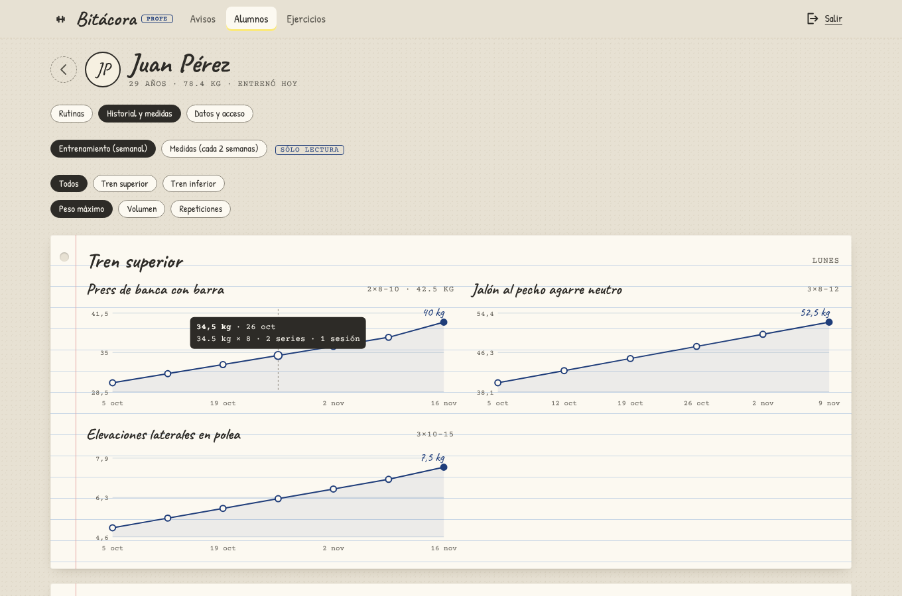

# Entrena con Fede — rutinas personalizadas y progreso

Web app para profe y alumnos. Funciona en el celular (se puede instalar como app desde el navegador) y en la compu. La estética es la de una planilla de papel: renglones, tinta azul, sellos y post-its.

## Capturas

| Alumno: planilla del día | Alumno: festejo | Profe: avisos de progresión |
|---|---|---|
|  |  |  |




## Qué hace

**Alumno** (pensado para el celular)
- Ve su plan con el objetivo, los días de la semana y los ejercicios (series, rango de reps, carga, pausa y nota del profe).
- Carga peso y reps por serie. Se guarda al salir de cada casillero, muestra en lápiz lo que hizo la sesión anterior y copia el peso de la serie anterior.
- Si la máquina está ocupada, elige una de las opciones de reemplazo que dejó el profe.
- Ve el video y la pauta técnica de cada ejercicio.
- Historial semanal, agrupado por día de entrenamiento (por ejemplo, tren superior) y dentro de cada día por ejercicio: peso máximo, volumen y repeticiones.
- Mediciones cada 2 semanas (peso, cintura, pecho, cadera, brazo, muslo y % de grasa), con aviso cuando toca medirse.
- Edita su nombre, edad y teléfono, y cambia su contraseña.
- **Doble progresión:** cuando completa todas las series en el tope del rango con la carga pautada, la app le avisa al profe. Cuando el profe aprueba, el alumno ve un festejo con sello y confeti, y la carga nueva ya queda en su planilla.

**Profe** (pensado para la compu, también funciona en el celular)
- Alta, baja y modificación de alumnos, de dos formas: invitación por mail o contraseña temporal. También puede pausar o reactivar el acceso, reenviar el mail de contraseña o eliminar al alumno.
- Armador de rutinas:
  - Plantillas de días.
  - Buscador instantáneo de ejercicios (sin importar acentos, con filtro por grupo muscular).
  - Botón "Cambiar" para reemplazar un ejercicio.
  - "Opciones de reemplazo" por si el ejercicio no está disponible en el gym.
  - Ordenar, duplicar y publicar rutinas.
- Biblioteca de 130 ejercicios en español con pauta técnica. A cada ejercicio le pegás el link de YouTube que prefieras (o un video tuyo) y se ve embebido.
- Bandeja de **avisos de progresión**: elegís cuánto sumar (+1, +2, +2,5, +5, +10 o cualquier otro valor), dejás una nota y aprobás o mantenés la carga. El alumno se entera al abrir la app.
- Historial de cada alumno en modo lectura: gráficos semanales por ejercicio y medidas.
- Lista de alumnos que no entrenan hace más de 7 días.

**Seguridad:** login con email y contraseña, y recuperación por mail (el link funciona aunque se abra en otro dispositivo). Toda la seguridad está en la base de datos (Row Level Security):
- Cada alumno ve sólo lo suyo.
- Cada profe ve sólo a sus alumnos.
- Sólo el profe puede crear o modificar rutinas.
- El alumno no puede cambiarse el rol.

## Tecnología

- Next.js 15 (App Router) + React 19 + TypeScript.
- Supabase: Postgres, Auth y Row Level Security.
- Sin librerías de UI: CSS propio y gráficos SVG propios.

## Publicarla (gratis): Supabase + Vercel

### 1. Base de datos (Supabase)
1. Creá un proyecto en <https://supabase.com>.
2. **SQL Editor → New query**: pegá y ejecutá todo `supabase/migrations/0001_schema.sql`.
3. Ejecutá también `supabase/seed_exercises.sql` (es el catálogo de ejercicios).
4. **Authentication → Sign In / Providers → Email**: desactivá *Allow new users to sign up*. Así sólo entran los alumnos que das de alta vos.
5. **Authentication → Users → Add user**: creá tu usuario de profe con tu email y contraseña. **El primer usuario que se crea queda como profe.**
6. **Authentication → URL Configuration**:
   - *Site URL*: la URL de la app, por ejemplo `https://entrena-con-fede.vercel.app`.
   - *Redirect URLs*: agregá `https://entrena-con-fede.vercel.app/**`.
7. **Mails (importante):** el servidor de mail que trae Supabase de fábrica manda muy pocos mails por hora y sólo es para pruebas. Para las invitaciones y la recuperación de contraseña configurá un SMTP propio en **Authentication → Emails → SMTP Settings**. Por ejemplo [Resend](https://resend.com), que es gratis hasta 3.000 mails por mes.
   - Mientras tanto podés dar de alta a los alumnos con **contraseña temporal**, que no necesita mail.
   - Opcional: en **Authentication → Emails → Templates** podés traducir los textos de los mails al español.

### 2. App (Vercel)
1. Subí esta carpeta a un repositorio de GitHub.
2. En <https://vercel.com> importá el repositorio.
3. Cargá las variables de entorno. Están en `.env.example` y los valores salen de Supabase → *Project Settings → API*:
   - `NEXT_PUBLIC_SUPABASE_URL`
   - `NEXT_PUBLIC_SUPABASE_ANON_KEY`
   - `SUPABASE_SERVICE_ROLE_KEY`: es secreta, nunca la compartas.
   - `NEXT_PUBLIC_SITE_URL`: la URL final de la app.
4. Deploy. Entrá con tu usuario de profe.

### 3. Instalarla en el celular
Abrí la URL en el celular:
- iPhone: Safari → Compartir → *Agregar a pantalla de inicio*.
- Android: Chrome → menú → *Instalar app*.

## Desarrollo local

```bash
npm install
cp .env.example .env.local   # completar con tus claves
npm run dev
```

Con Docker podés levantar Supabase local con `npx supabase start`. Eso aplica la migración y el catálogo, y los mails de prueba se ven en `http://127.0.0.1:54324`.

## Estructura

```
supabase/migrations/0001_schema.sql   tablas, seguridad (RLS) y lógica de doble progresión
supabase/seed_exercises.sql           catálogo base (se genera con: npm run seed:sql)
scripts/exercises.mjs                 lista editable de ejercicios
src/app/alumno/…                      plan, planilla del día, historial y perfil
src/app/profe/…                       avisos, alumnos, armador de rutinas y biblioteca
src/app/(login, recuperar, auth/…)    acceso y recuperación de contraseña
src/components/…                      gráficos, video, festejo y buscador de ejercicios
```

### Carga inicial opcional
Al armar la rutina, la carga (kg) de cada ejercicio es opcional. Si la dejás vacía, el alumno la define en su primera sesión: el peso más bajo que cargue ese día queda como su carga inicial. Mientras dure esa sesión la puede corregir; después ya no cambia. En el armador ves que la eligió el alumno. Si la modificás, pasa a ser tuya.

### Cómo funciona la doble progresión
1. El alumno carga sus series. Un *trigger* de la base controla que **todas** las series pautadas tengan reps ≥ tope del rango y peso ≥ carga pautada. Si se cumple, crea un pedido pendiente. Los ejercicios de reemplazo no cuentan.
2. El profe lo ve en **Avisos** y aprueba con el incremento que elija. La función `resolve_progression` actualiza la carga del ejercicio en la rutina.
3. La próxima vez que el alumno abre la app ve el festejo con la carga nueva. Se muestra una sola vez.
